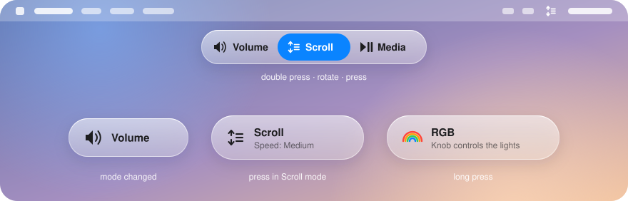

<p align="center">
  <picture>
    <source media="(prefers-color-scheme: dark)" srcset="docs/images/keyboard-dark.svg">
    
  </picture>
</p>

# AulaWheel

Turn the volume knob of the **AULA F75** into a scroll wheel, a media scrubber and a volume dial on macOS.

<p align="center"></p>

## What it does

| Mode | Rotate | Press |
|---|---|---|
| **Volume** | Volume up / down (⌥ fine steps) | Mute |
| **Scroll** | Scroll the window under the pointer (⇧ horizontal, ⌥ slow, ⌘ zoom) | Change speed: slow / medium / fast |
| **Media** | Seek in the focused player (⇧ 3× further) | Play / pause |

- **Double press** opens the mode picker. Rotate to choose a mode, then press.
- **Long press** still switches the knob between Volume and RGB, as on the keyboard itself.
- A small HUD below the menu bar shows each change.
- **F10, F11 and F12** keep working as mute and volume keys.

## Install

Download the DMG from the [latest release](https://github.com/sonla58/aula-wheel-macos/releases/latest), open it and drag AulaWheel into Applications.

Release builds are not notarized, so each time you open a newly downloaded version macOS will refuse it. Open System Settings → Privacy & Security and click **Open Anyway**.

Releases from 0.0.2 on are signed with the same certificate, so Accessibility and Input Monitoring should stay allowed when you update. Coming from 0.0.1 (which was signed differently), remove AulaWheel from both lists and add it again once (the setup window shows you how).

### Updates

AulaWheel checks GitHub for a new release once a day and downloads it in the background. Before using a download it checks that the download is signed with the same certificate as the copy you have, which also keeps Accessibility and Input Monitoring allowed. The update is installed when you choose **Restart to Update** in the menu bar, when you quit AulaWheel, when it next starts, or after 10 minutes without keyboard or mouse input. While AulaWheel restarts, the knob and F10–F12 work as they do without the app.

Turn off **Update Automatically** in the menu to check only when you choose **Check for Updates**. AulaWheel can only replace itself from a folder you can write to, such as Applications, and only when it is a release build. Otherwise the menu says why and links to the download.

On first launch a setup window walks you through allowing **Accessibility** and **Input Monitoring** (a small guide sits next to System Settings and shows what to turn on), connecting the keyboard, and trying each knob gesture. Reopen it any time with **Setup Guide…** in the menu bar.

Requires macOS 14 or later (the Liquid Glass HUD needs macOS 26).

### Build from source

```sh
git clone https://github.com/sonla58/aula-wheel-macos.git
cd aula-wheel-macos
scripts/build-app.sh --install
```

Building needs Xcode 16 or later.

The build is signed with your first Apple Development certificate if you have one, so permissions survive rebuilds. Without one it is ad-hoc signed, and you have to allow AulaWheel again after each build. Maintainers: releases are signed with a self-signed certificate made once by `scripts/make-signing-cert.sh` and pinned in `scripts/release-cert.sha1`. Only the release workflow gets the key, and it fails rather than attach a build signed any other way, so set the `SIGNING_CERT_P12` and `SIGNING_CERT_PASSWORD` secrets before publishing a release.

## Customize

Choose **Open Config File** in the menu bar. The file is `~/Library/Application Support/AulaWheel/config.json`, and it reloads when you save it. You can change any mode, gesture, modifier binding, scroll speed or timing there.

## Limitations

- Tested with the AULA F75 over Bluetooth and the 2.4 GHz receiver. Other AULA models and a cable are used too, but the menu marks them as unverified. If yours works, add its product ID to `device.productIDs` in the config.
- While the knob is in RGB mode, the keyboard handles it itself and AulaWheel can't use it.
- A very quick F11 or F12 tap right after turning the knob may be read as the knob.
- There is no LED or lighting-profile control yet.
- If the app crashes, the knob and F10–F12 do nothing until you reopen it or reconnect the keyboard.

## License

[MIT](LICENSE). Not affiliated with AULA.
